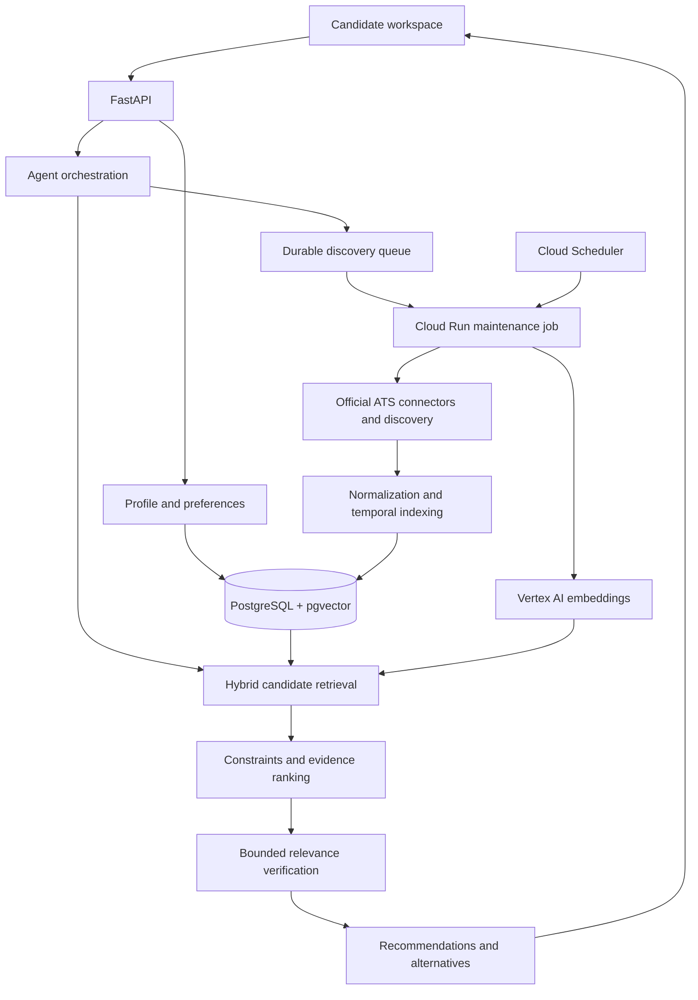

# BoardForge

An evidence-grounded job discovery and recommendation agent combining hybrid retrieval, resume personalization, persistent preferences and bounded LLM reasoning.

[Live application](https://boardforge-api-779231143197.us-central1.run.app/) · [Architecture](docs/architecture.md) · [Evaluation](docs/results.md) · [Deployment](deploy/gcp/README.md)

**Status:** Deployed invitation-only beta. Reviewer access is shared privately.

## Why BoardForge?

Semantic similarity alone cannot establish whether a candidate is eligible for a job. BoardForge separates deterministic eligibility checks, temporal job state and user preferences from probabilistic relevance judgments. It returns evidence and flags uncertain matches rather than treating every result as a recommendation.

## Results at a glance

- 1,097 active jobs in the November 28, 2026 production snapshot.
- Hybrid candidate recall: **94.37%**, versus 66.81% for lexical retrieval.
- Recommendation precision after LLM verification: **95.83%**, versus 47.89% before verification, on 32 queries with relevant jobs.
- Latest recorded full clean-environment regression: 333 passed, 4 skipped.

The offline holdout contains 100 real postings and 36 intents (3,600 AI-audited relevance judgments, not human-verified labels). These metrics are not real-user satisfaction or guaranteed production performance.

## Features

- Natural-language search, resume extraction and editable candidate preferences.
- PostgreSQL full-text and pgvector retrieval, deterministic constraints and evidence reranking.
- Structured LLM relevance verification and bounded tool-calling agent.
- Background discovery of official ATS boards and temporal job indexing.
- Persistent feedback, isolated candidate workspaces and usage quotas.

## Architecture



Ordinary searches use the existing index. Complex conditional requests can invoke bounded reasoning; external discovery runs asynchronously. Known hard constraints remain authoritative.

## Evaluation

### Retrieval holdout

| Metric | Lexical | Hybrid | Exhaustive reference |
|---|---:|---:|---:|
| Candidate recall | 0.6681 | 0.9437 | 1.0000 |
| Precision@10 | 0.2406 | 0.3312 | 0.3250 |
| Recall@10 | 0.3791 | 0.5607 | 0.5528 |
| NDCG@10 | 0.4210 | 0.5771 | 0.5720 |

### Relevance verification (identical retrieval candidate sets)

| Metric | Deterministic hybrid | LLM verified |
|---|---:|---:|
| Recommendation precision | 0.4789 | 0.9583 |
| Recommendation recall | 0.2944 | 0.1991 |
| Irrelevant recommendation rate | 0.5211 | 0.0417 |
| NDCG@10 | 0.5771 | 0.6243 |
| False recommendations | 74 | 2 |

Both tables concern the 32 queries with relevant jobs. Verification trades recall for precision. On four queries without relevant jobs, false recommendations decreased from eight to five. See [measured results](docs/results.md) for resource usage, synthetic benchmarks and limitations.

## Stack

Python, FastAPI, PostgreSQL, pgvector, SQLite (local fallback), Vertex AI Gemini, Tavily, Docker, Cloud Run, Cloud Scheduler, Secret Manager, Neon, pytest and GitHub Actions.

## Local development

Python 3.11 or later. Create a virtual environment:

```bash
python -m venv .venv
```

Activate it (`.venv/Scripts/activate` on Windows Git Bash; `source .venv/bin/activate` on Linux/macOS), then:

```bash
pip install -e ".[dev]"
pytest -q
uvicorn boardforge.api:app --reload
```

Open http://127.0.0.1:8000. SQLite is the zero-configuration fallback; optional AI integrations require provider configuration. For PostgreSQL and the independent worker:

```bash
docker compose up --build
```

See [.env.example](.env.example) for configuration. Never use production credentials for local tests.

## Evaluation commands

```bash
python -m boardforge.cli benchmark
python -m boardforge.cli agent-eval
python -m boardforge.cli preference-eval
python -m boardforge.cli resume-eval
python -m boardforge.cli holdout-eval
python -m boardforge.cli relevance-eval
```

The last two commands default to planning mode; paid execution requires explicit flags and isolated storage.

## Production and limitations

The beta uses invitation credentials, profile authorization, persistent UTC-day quotas and an estimated cumulative AI-cost ledger. Cloud Scheduler is configured for twice-daily maintenance. Raw resume files are not persisted; extracted profile and usage information may be retained. Refreshing the browser requires reopening the invitation in a new tab or re-authenticating.

- AI-audited labels and a small frozen corpus limit generalization.
- Production embedding coverage is partial; production verifier limits differ from the offline experiment.
- Complex live-agent validation remains incomplete; human feedback is still needed.
- Job eligibility and availability must be confirmed at the original posting.
- Static invitations are a beta mechanism, not consumer-grade identity management.

## Documentation

[Architecture](docs/architecture.md) · [Evaluation methodology](docs/evaluation.md) · [Measured results](docs/results.md) · [Engineering log](docs/engineering-log.md) · [Historical development reference](docs/development-reference.md) · [GCP deployment](deploy/gcp/README.md)
